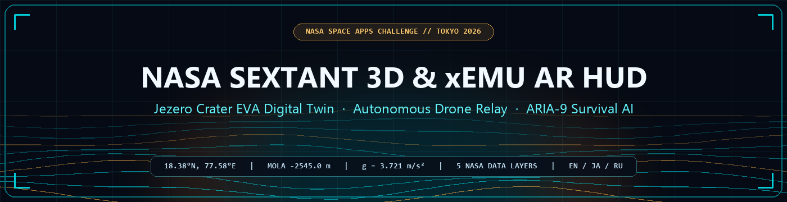
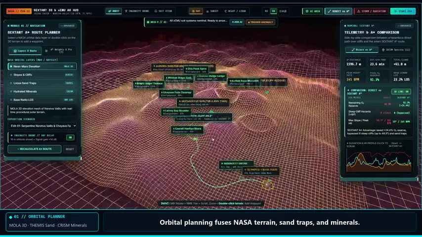
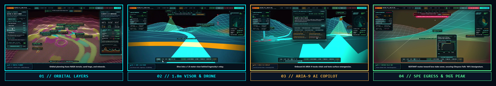
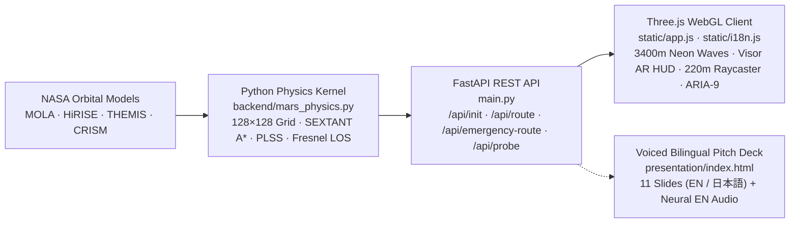

<div align="center">

<a href="./NASA_SEXTANT_Demo_EN.mp4">
  
</a>

<br/><br/>

[](https://www.python.org/)
[](https://fastapi.tiangolo.com/)
[](https://threejs.org/)
[](https://numpy.org/)
[](./NASA_SEXTANT_Demo_EN.mp4)
[](#-quick-start)

<br/>

[🎬 Demo Video](#-mission-demo--highlights) &nbsp;•&nbsp; [🇺🇸 English Docs](#-english-documentation) &nbsp;•&nbsp; [🇯🇵 日本語ドキュメント](#-日本語ドキュメント) &nbsp;•&nbsp; [🛰️ NASA Data](#-nasa-datasets--physics-standards-used) &nbsp;•&nbsp; [🚀 Quick Start](#-quick-start)

</div>

---

## 🎬 Mission Demo & Highlights

<div align="center">

<a href="./NASA_SEXTANT_Demo_EN.mp4">
  
</a>

<br/><br/>

[-NASA__SEXTANT__Demo__EN.mp4-00F5FF?style=for-the-badge&labelColor=0A1322)](./NASA_SEXTANT_Demo_EN.mp4)
&nbsp;
[-presentation%2Findex.html-FFB84A?style=for-the-badge&labelColor=0A1322)](./presentation/index.html)

<br/>



</div>

<details open>
<summary><b>⏱️ Demo Video Chapters — 37.9s Full HD (1920×1080 · English Voiceover + ARIA-9 Suit Radio)</b></summary>

| Time | Chapter | What Happens in Simulator |
| :--- | :--- | :--- |
| **`00:00 – 00:03`** | **Jezero Opening** | Mars surface context — Earth light-speed lag requires autonomous visor navigation (`MOLA -2545 m`, `g = 3.721 m/s²`). |
| **`00:04 – 00:08`** | **`01` Orbital Layers** | Toggling **THEMIS** loose sand traps and **CRISM** hydrated mineral layers while inspecting `+24.4% O₂` SEXTANT A* efficiency. |
| **`00:08 – 00:12`** | **`02` 1.8m xEMU Visor** | Launching **`START EVA`**: camera dives from orbit straight into eye-level AR visor led by the **Ingenuity** forward scout drone. |
| **`00:12 – 00:18`** | **`03` CRISM Spectroscopy** | Locking the spectrometer onto **Lefroy Bay (91% Opal-A)** and **Castell Henllys (82% Carbonate)** while Ingenuity bridges blocked canyon UHF radio (`+14 dB`). |
| **`00:18 – 00:23`** | **`04` ARIA-9 AI Copilot** | Opening onboard tactical AI **ARIA-9** to inspect real-time ECG/PLSS vitals and trigger off-nominal survival simulations. |
| **`00:23 – 00:34`** | **`05` SPE X9.4 Storm Egress** | Solar radiation spikes past `1100 µSv/h`; ARIA-9 sounds helmet alert and plots fastest `149.6 m` cover to **Hephaestus Lava Tube**—locking **Cheyava Falls (96% Peak Biosignature)**. |
| **`00:34 – 00:38`** | **Mission Briefing End** | Stack recap and GitHub repository overview. |

</details>

---

## 🇺🇸 English Documentation

**NASA SEXTANT 3D & xEMU AR HUD** is a browser-native, full-stack Mars EVA (Extravehicular Activity) digital twin unifying **orbital scientific route planning**, an **autonomous Ingenuity scout drone**, a **first-person xEMU helmet Augmented Reality HUD**, and **ARIA-9**, an onboard survival AI copilot inside one continuous **60 FPS Three.js WebGL** environment powered by **FastAPI + NumPy**.

<div align="center">

| Terrain Grid | Oxygen Ceiling | Drone Relay Gain | Crater Science | Crisis Drills | Languages |
| :---: | :---: | :---: | :---: | :---: | :---: |
| **`128 × 128`**<br/><sub>10 m resolution · 3.4 km horizon</sub> | **`580 L O₂`**<br/><sub>Pandolf metabolic burn</sub> | **`+14 dB UHF`**<br/><sub>18 m forward recon</sub> | **`8 Outcrops`**<br/><sub>Up to 96% Cheyava Falls</sub> | **`4 Protocols`**<br/><sub>Autonomous AI recovery</sub> | **`EN · 日本語 · RU`**<br/><sub>Live UI & Voiced Deck</sub> |

</div>

> [!IMPORTANT]
> **Why It Matters:** Because Earth-Mars light-speed communication lag prevents real-time Mission Control intervention, suited astronauts inside steep Jezero Crater canyons must rely on autonomous onboard terrain intelligence to avoid cliff falls, unconsolidated sand traps, radio blackouts, oxygen depletion, and solar radiation storms.

### ✨ Key Capabilities

<table>
<tr>
<td width="50%" valign="top">

#### 🛰️ Phase 1 — Orbital Mission Planner
- **5 Toggleable NASA Layers**: Switch instantaneously between *Neon-Mars 3D Altimetry (MOLA)*, *Slope Hazards (HiRISE)*, *Sand Slip / Thermal Inertia (THEMIS)*, *Mineral Spectra (CRISM)*, and *Base Radio Visibility (UHF LOS)*.
- **Contour-Following SEXTANT A\***: Multi-objective weighted A* pathfinder penalizing steep climbs (`>21°` blocked in nominal mode), high-slip sand pockets, and UHF shadows while rewarding high-science mineral zones, smoothed into a continuous `CatmullRomCurve3` chevron path.
- **Interactive Planning**: 3 Jezero mission presets (`EVA-01`, `EVA-02`, `EVA-03`), live safety weight sliders (`Slope`, `Sand`, `Comm`), and **double-click anywhere on the 3D terrain** to insert custom waypoints.

</td>
<td width="50%" valign="top">

#### 📊 Direct Path vs. SEXTANT A* Proof
- **3D Hazard Overlay**: Renders the naive direct line alongside crimson hazard cones marking steep cliffs (`>=19.5°`) and an AR pin highlighting the worst terrain choke point.
- **Side-by-Side Analytics**: Quantifies final remaining `O₂`, cliff exposure (`>19°`), max slope, peak heart rate, and saved oxygen percentage (`+24.4%` on `EVA-01`).
- **Interactive Elevation & HR Chart**: Dual telemetry profile (`Elevation` + `BPM`) along the entire traverse—click anywhere on the chart to scrub the EVA timeline.

</td>
</tr>
<tr>
<td width="50%" valign="top">

#### 🧑‍🚀 Phase 2 — xEMU Visor AR HUD & PLSS
- **Seamless Camera Dive**: Smooth transition from orbital 3D view straight down into astronaut eye level (`1.8 m` helmet height) with 360° free look.
- **Live PLSS Biometrics**: Coupled Pandolf/SEXTANT metabolic calculation (`175–960 W`), synthesized real-time Canvas ECG trace (`70–176 BPM`), `LCVG` water loop cooling (`18.0–27.8 °C`), and high-pressure `O₂` reserve (`580 L` tank, `0.75–3.25 L/min`).
- **Dual 20 m Tactical Radar**: 8 azimuthal sectors (`45°` each) scanning inner `10 m` and outer `20 m` hazards plus bearing vectors to **Olympus-1 Base** and nearest shelter.
- **Solar & LIDAR Lighting Modes**: Instant switching between **Day**, **Sunset**, and **Night / LIDAR** wireframe mode with helmet spotlight.

</td>
<td width="50%" valign="top">

#### 🚁 Ingenuity Scout & 🔬 CRISM/PIXL Scanner
- **Ingenuity Wingman (`18 m` Ahead)**: Coaxial dual-rotor drone flying ahead with a downward volumetric LIDAR scan cone, **orbitable 360° + scroll-zoom Drone View**, and **`+14 dB` UHF communication relay** bridging canyon RF dead zones.
- **220 m Spectral Target Lock**: `THREE.Raycaster` visor reticle locks onto **8 cataloged Jezero outcrops** (with one-click Auto-Aim), firing a laser beam and displaying biosignature score, 7 chemical oxides, and `0.8–2.6 µm` NIR absorption spectra.

</td>
</tr>
</table>

#### 🤖 ARIA-9 AI Copilot & 4 Autonomous Crisis Protocols

- **Silent Visual Mini-Dock + Chat Assistant**: Non-intrusive live ticker with neural oscilloscope waveform, proactive `180 m` forward terrain lookahead warnings, and interactive Q&A across suit status, terrain ahead, minerals, A* advantage, shelters, and Mars weather.
- **4 Playable Emergency Scenarios**:
  1. **`[01]` Trail Rockfall**: Spawns basalt obstacles directly on the path; AI inserts a `42 m` lateral detour waypoint and replans SEXTANT A*.
  2. **`[02]` LCVG Cooling Fault & O₂ Leak**: Simulates a spike (`26.4 °C`, `162 BPM`, `2.38 L/min`); AI isolates the damaged loop and switches to Backup Loop B.
  3. **`[03]` `65 m` Dust Devil Vortex**: Drops UHF link by `-28 dB`; AI maximizes the Ingenuity `+14 dB` relay and engages helmet LIDAR illumination.
  4. **`[04]` `SPE X9.4` Solar Radiation Storm**: Triggers crimson storm fog (`THREE.FogExp2`) and computes the fastest-time emergency egress path to hardened shelters (*Hephaestus Lava Tube* `99.4%`, *Aurora Bunker* `96.8%`, *Kodiak-South Alcove* `92.0%`, or *Olympus-1 Base* `99.8%`).

---

### 🛰️ NASA Datasets & Physics Standards Used

| NASA Mission / Standard | Dataset / Model Parameters | Role in Simulator |
| :--- | :--- | :--- |
| **MGS MOLA DEM** | Coordinates `18.38°N, 77.58°E` (Western Delta, Neretva Vallis, Séítah, Kodiak), `-2545.0 m` baseline, Mars gravity `g = 3.721 m/s²` | `128 × 128` discrete elevation grid (`10 m/cell` = `1280 × 1280 m`) + `3400 m` Neon Waves outer horizon |
| **MRO HiRISE** | `0°–40°` topographic slope gradients (`<9°` safe, `>=19.5°` hazard cones, `>21°` normal A* limit) | Cliff hazard overlay & steep-climb avoidance solver |
| **2001 Mars Odyssey THEMIS** | Thermal Inertia Units (TIU) & unconsolidated Aeolian regolith slip index | Sand trap visualization, traction loss & locomotion effort penalty |
| **MRO CRISM + Perseverance PIXL / SHERLOC** | 5 mineral classes (Phyllosilicates, Carbonates, Sulfates, Hematite, Hydrated `SiO₂`), `0.8–2.6 µm` NIR spectra & 7 oxides (`SiO₂`, `FeO`, `MgO`, `Al₂O₃`, `CaO`, `SO₃`, `H₂O/CO₂`) | 8 analog Jezero outcrops (*Cheyava Falls* `96%`, *Bright Angel* `93%`, *Lefroy Bay* `91%`, *Wildcat Ridge* `88%`, *Otis Peak* `84%`, *Castell Henllys* `82%`, *Kodiak Base* `79%`, *Skinner Ridge* `76%`) |
| **NASA SEXTANT + Pandolf + xEMU / PLSS** | Metabolic exertion (`175–960 W`), HR (`70–176 BPM`), LCVG cooling (`18.0–27.8 °C`), `580 L` O₂ reserve (`0.75–3.25 L/min`), `1.8 m` visor eye height | Contour traverse cost function & live helmet telemetry HUD |
| **Ingenuity + Deep Space Comm / SPE** | Coaxial forward recon (`18 m`, `+14 dB` relay), FSPL + Fresnel ridge diffraction (`15 m` Olympus-1 tower), Solar Particle Event (`SPE X9.4`) shielding | Canyon UHF radio shadow map & emergency shelter egress routing |

---

### 🏗️ Architecture



#### REST API Endpoints
- `GET /api/init` — Returns terrain arrays, all NASA science layers, infrastructure (`hab_base`, `shelters`, `rover`, `boulders`), 3 mission presets, and computed initial A* timeline.
- `POST /api/route` — Runs weighted SEXTANT A* across arbitrary waypoints and returns step-by-step PLSS metabolic/O₂ telemetry.
- `POST /api/emergency-route` — Evaluates fastest emergency evacuation paths from current suit coordinates to Olympus-1 Base and all 3 radiation shelters.
- `GET /api/probe?x=...&z=...` — Returns full multi-layer NASA measurements for any `(x, z)` coordinate on the map.

---

### 🚀 Quick Start

#### 1. Run the Main 3D & AR Simulator
```bash
pip install -r requirements.txt
uvicorn main:app --host 127.0.0.1 --port 8000
```
Open **`http://127.0.0.1:8000`** in your browser. Use **`RU | EN | 日本語`** in the top bar to switch UI telemetry, mineral specs, and ARIA-9 AI responses instantly.

#### 2. Open the Voiced Presentation Deck (`EN` / `日本語`)
Open **`presentation/index.html`** directly in any browser (works offline over `file:///` with zero extra servers):
- Click **`Voice EN`** (or press **`V`**) to play studio English keynote narration for the active slide
- Click **`Auto`** (or press **`A`**) for hands-free auto-advancing presentation mode across all 11 slides
- Toggle **`EN` / `日本語`** (`L`), navigate with **`←` / `→` / `Space`**, Speaker Notes (**`N`**), Grid (**`G`**), PDF Export (**`P`**), Fullscreen (**`F`**)

#### 📁 Repository Structure
```text
├── main.py                       # FastAPI application & static hosting
├── requirements.txt              # FastAPI, Uvicorn, NumPy, Pydantic
├── NASA_SEXTANT_Demo_EN.mp4      # Full 1080p edited demo video with English voiceover
├── backend/
│   └── mars_physics.py           # Jezero terrain, A* solver, PLSS biometrics, LOS & outcrops
├── static/
│   ├── index.html                # Orbital UI + xEMU Visor HUD + ARIA-9 AI Copilot
│   ├── styles.css                # Mars Neon Waves holographic aerospace theme
│   ├── app.js                    # Three.js 3D scene, Drone, Raycaster, ECG/Radar canvases
│   ├── i18n.js                   # Full RU / EN / JA localization engine
│   └── vendor/                   # Three.js & OrbitControls modules
├── presentation/
│   ├── index.html                # 11-slide bilingual presentation deck (EN / 日本語)
│   ├── styles.css                # 16:9 Mars Neon keynote styles & voice player UI
│   ├── slides-data.js            # Bilingual slide copy & 6-min speaker script cues
│   ├── deck.js                   # Slide engine, audio player & Neon Waves backdrop
│   └── audio/                    # Pre-rendered neural English voiceover (slide_01..11.mp3)
└── docs/
    ├── hero_banner.png           # Custom Neon-Mars README header
    ├── demo_preview.webp         # Animated 24-bit README highlight reel
    └── showcase_strip.png        # 4-stage Mars EVA mission storyboard
```

---

<br/>

## 🇯🇵 日本語ドキュメント

**NASA SEXTANT 3D & xEMU AR HUD** は、火星ジェゼロ・クレーター（`18.38°N, 77.58°E`）での船外活動（EVA）を対象とした一気通貫型のデジタルツイン・シミュレーターです。**Python (FastAPI + NumPy)** による物理・経路・生体演算エンジンと、**Three.js (WebGL 60 FPS)** による3D軌道計画・先導ドローン・ヘルメットAR HUD・搭載AIコパイロット **ARIA-9** を単一のリアルタイム空間に統合しています。

<div align="center">

| 地形グリッド | 酸素タンク容量 | ドローン中継利得 | 科学調査対象 | 緊急プロトコル | 対応言語・音声 |
| :---: | :---: | :---: | :---: | :---: | :---: |
| **`128 × 128`**<br/><sub>10 m 解像度 · 3.4 km 地平</sub> | **`580 L O₂`**<br/><sub>Pandolf 代謝消費演算</sub> | **`+14 dB UHF`**<br/><sub>前方 18 m 先行偵察</sub> | **`8 露頭地点`**<br/><sub>Cheyava Falls 96%</sub> | **`4 シナリオ`**<br/><sub>AI 自律危機回避</sub> | **`EN · 日本語 · RU`**<br/><sub>UI切替 & 英語音声付スライド</sub> |

</div>

> [!NOTE]
> **背景と意義：** 地球と火星の間には数分〜20分超の電波遅延が存在するため、地球の管制室は目の前の急崖・軟弱砂地・太陽放射線嵐に対してリアルタイムで指示を出せません。本システムはNASAの衛星観測データと生体力学モデルを自律ナビゲーションへ直結し、宇宙飛行士の安全と科学成果を最大化します。

### 🎬 英語音声付きフルHDデモ動画

ページ上部のアニメーションプレビューをクリックするか、以下のリンクから **1080p ナレーション・字幕付きデモ動画（37.9秒）** を再生できます：
- **[▶ NASA_SEXTANT_Demo_EN.mp4 を再生（英語ナレーション + ARIA-9警報音声 + テロップ付き）](./NASA_SEXTANT_Demo_EN.mp4)**

### ✨ 主な機能

- **🛰️ フェーズ1：軌道ミッション計画 & 5層のNASAデータ融合**
  - **5種類の衛星観測レイヤー切替**：`Neon-Mars 3D標高 (MOLA)`、`傾斜角・断崖リスク (HiRISE)`、`流砂・砂丘トラップ (THEMIS)`、`含水鉱物スペクトル (CRISM)`、`基地UHF見通し通信 (UHF LOS)`。
  - **等高線追従 SEXTANT A\***：通常探索時は `21°` 超の急崖を回避し、軟弱砂丘や通信遮蔽ペナルティを抑えつつ有望鉱物エリアを優先する3D最適ルートを `CatmullRomCurve3` で滑らかに生成します。
  - **直感的な編集**：3種の探査シナリオ（`EVA-01`〜`03`）、リアルタイム安全重みスライダー、および **3D地形のダブルクリックによる任意経路点追加** に対応。
- **📊 「直線ルート vs SEXTANT A\*」定量比較HUD**
  - 3D空間上に `>=19.5°` の危険急崖コーンと最悪リスク地点ピンを表示し、直線経路の危険性とA\*ルートによる酸素（`O₂`）節約（`+24.4%`）・最大心拍数抑制をグラフ（クリックで時間移動可能）と表で可視化します。
- **🧑‍🚀 フェーズ2：xEMU 宇宙服バイザーAR HUD（高度 1.8 m 一人称視点）**
  - 軌道視点から地上1.8 mのヘルメット内部へシームレスに降下し、マウスで360度見回し可能。
  - **PLSS 生体テレメトリ**：Pandolf / SEXTANT代謝負荷（`175–960 W`）、リアルタイム描画心電図（`70–176 BPM`）、LCVG冷却水温（`18.0–27.8 °C`）、高圧酸素タンク（`580 L` / 消費 `0.75–3.25 L/min`）。
  - **20 m 8方位警戒レーダー & 光照モード**：半径 `10 m / 20 m` の地形警戒、**オリンポス1基地** 方向表示に加え、`昼 (SOL)` / `夕暮れ` / `夜間・LIDAR` モードをワンクリックで切替可能。
- **🚁 自律偵察ドローン「Ingenuity」 & 🔬 CRISM / PIXL 分光スキャナ**
  - 宇宙飛行士の前方 `18 m` を飛行し、真下へLIDAR走査コーンを照射。**360度回転・ズーム可能な専用ドローン視点**と、峡谷陰での **`+14 dB` UHF電波中継** 機能を備えています。
  - `220 m` 範囲の `THREE.Raycaster` 照準（自動照準ボタン対応）で、**ジェゼロ・クレーターの実在露頭8種**（*Cheyava Falls* `96%` 等）をロックし、7種類の酸化物組成と近赤外スペクトル（`0.8–2.6 µm`）を表示します。
- **🤖 搭載AI「ARIA-9」 & 4大緊急異常事態プロトコル**
  - **視覚特化Mini-Dock & 対話チャット**：音声の邪魔を排したニューラル波形表示、進行方向 `180 m` 先までの自動危険先読み警告、および状態・地形・鉱物・シェルター等のリアルタイムQ&Aを実行。
  - **4つの突発トラブル実演シミュレーション**：
    1. **`[01]` 渓谷縁の落石・崩落**：ルート上の3D落石発生 → AIが横 `42 m` の回避ポイントを自動挿入しA\*再計算。
    2. **`[02]` LCVG冷却不全・酸素漏洩**：水温 `26.4 °C` / 心拍 `162 BPM` / 酸素消費 `2.38 L/min` 異常 → 損傷ループ遮断・予備ループBへ切替。
    3. **`[03]` 巨大塵旋風（高さ `65 m`）**：UHF信号 `-28 dB` 減衰 → ドローン `+14 dB` 中継最大化＆ヘルメットLIDAR点灯。
    4. **`[04]` 太陽フレア SPE X9.4 嵐**：深紅の放射線霧を展開し、最寄りシェルター（*ヘファイストス溶岩洞* `99.4%`、*オーロラ地下壕* `96.8%`、*コディアック南* `92.0%`、*オリンポス1基地* `99.8%`）へ最短時間A\*で緊急退避。

---

### 🛰️ 使用したNASA探査データ・工学モデル

| NASAミッション / 標準モデル | 採用パラメータ・仕様 | システムでの活用内容 |
| :--- | :--- | :--- |
| **MGS MOLA DEM** | ジェゼロ・クレーター座標 `18.38°N, 77.58°E`（西部三角州・ネレトヴァ渓谷・セイタ・コディアック）、基準標高 `-2545.0 m`、火星重力 `g = 3.721 m/s²` | `128 × 128` 離散地形グリッド（`10 m`刻み / `1280 × 1280 m`）＆ 外周 `3400 m` 地形生成 |
| **MRO HiRISE** | 路面傾斜角 `0°–40°`（`<9°` 安全帯、`>=19.5°` 赤色危険コーン、`>21°` 通常A\*制限） | 断崖ハザード可視化および急斜面回避コスト |
| **2001 Mars Odyssey THEMIS** | 熱慣性（TIU）および細粒風成砂レゴリス・スリップ指数 | 軟弱砂地トラップ可視化と歩行代謝ペナルティ計算 |
| **MRO CRISM + Perseverance PIXL / SHERLOC** | 5鉱物クラス（粘土・炭酸塩・硫酸塩・赤鉄鉱・含水 `SiO₂`）、`0.8–2.6 µm` 近赤外帯、7酸化物（`SiO₂`, `FeO`, `MgO`, `Al₂O₃`, `CaO`, `SO₃`, `H₂O/CO₂`） | *Cheyava Falls*（`96%`）、*Bright Angel*（`93%`）、*Lefroy Bay*（`91%`）など8種の実在モデル露頭 |
| **NASA SEXTANT + Pandolf + xEMU / PLSS** | 代謝負荷（`175–960 W`）、心拍（`70–176 BPM`）、LCVG冷却（`18.0–27.8 °C`）、`580 L` 酸素容量、視点高さ `1.8 m` | 等高線追従ルートコスト評価＆宇宙服AR HUD生体計算 |
| **Ingenuity + 深宇宙UHF + SPE防護** | 先行偵察（前方 `18 m`・`+14 dB` 中継）、高さ `15 m` 基地塔からのFSPL＋フレネル回折損失、`SPE X9.4` 放射線遮蔽モデル | 峡谷陰の通信死角解析および緊急避難シェルター誘導 |

---

### 🚀 クイックスタート

#### 1. メイン3Dシミュレーターの起動
```bash
pip install -r requirements.txt
uvicorn main:app --host 127.0.0.1 --port 8000
```
ブラウザで **`http://127.0.0.1:8000`** を開き、右上の **`RU | EN | 日本語`** で言語を切り替えられます。

#### 2. 英語音声付きプレゼンテーションの表示 (`EN` / `日本語`)
[**`presentation/index.html`**](./presentation/index.html) をブラウザで直接開きます（`file:///` 環境でスタンドアロン動作）：
- **`Voice EN`（`V` キー）** で各スライドのスタジオ品質英語ナレーションを再生
- **`Auto`（`A` キー）** で全11スライドの自動送り再生
- **`EN` / `日本語`**（`L` キー）切替、**`←` / `→` / `Space`** でスライド移動、**`N`** でスピーカーメモ、**`G`** で一覧、**`P`** でPDF出力、**`F`** で全画面表示
